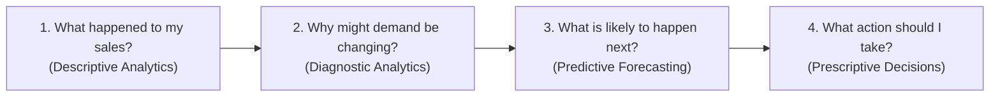

# DemandIQ 2.0 — Business Metrics & Decision-Support Guide

A practical, non-technical reference guide designed for retail store owners, inventory managers, and merchandisers.

---

## 1. The Four Core Business Questions

DemandIQ 2.0 exists to provide straightforward, data-grounded answers to four operational questions:

---

## 2. Descriptive Analytics: "What Happened to My Sales?"

### 2.1 Total Revenue & Units Sold
- **What this shows**: The aggregate dollar volume and physical piece count sold across your entire catalog or selected category over the filtered date window.
- **Why it matters**: Provides top-line business velocity and inventory turnover volume.
- **How to interpret it**: A rising revenue figure with flat units sold indicates price increases or a shift toward higher-ticket items, whereas rising units with declining revenue indicates heavy discounting or margin erosion.
- **Action to consider**: If revenue is growing slower than units sold, audit your markdown strategy to confirm discounts are driving profitable basket growth rather than unnecessary margin sacrifice.

### 2.2 Average Selling Price (ASP)
- **Formula**:
  $$\text{ASP} = \frac{\text{Total Revenue}}{\text{Total Units Sold}}$$
- **What this shows**: The average net dollars collected per unit sold across the business.
- **Why it matters**: Reveals whether customer purchasing behavior is shifting toward premium or budget tiers.
- **How to interpret it**: If ASP drops month-over-month while demand is steady, check whether price promotions or clearance sales pulled down the realization per item.
- **Action to consider**: For categories with falling ASP, bundle complementary accessories (e.g. phone cases with smartphones) to lift transaction values.

### 2.3 Month-over-Month (MoM) & Year-over-Year (YoY) Growth
- **What this shows**: 
  - **MoM Growth**: Immediate short-term sales momentum relative to the preceding calendar month.
  - **YoY Growth**: Benchmark comparison against the exact same calendar month one year prior.
- **Why it matters**: MoM reveals immediate velocity, while YoY filters out seasonal swings (e.g., comparing December 2024 to December 2023 rather than December to November).
- **How to interpret it**: A positive MoM during holiday season is normal; a positive YoY confirms true underlying annual expansion.
- **Action to consider**: If YoY growth turns negative for two consecutive quarters, review supplier pricing, competitor offerings, or catalog freshness.

### 2.4 Best & Worst Performing Products
- **What this shows**: Top 5 revenue generators vs. bottom 5 sluggish items across your active catalog.
- **Why it matters**: Focuses working capital and replenishment attention on the 20% of products driving 80% of top-line cash flow (Pareto principle).
- **How to interpret it**: High revenue with low unit count indicates high-margin luxury goods; high volume with moderate revenue indicates daily fast-moving essentials.
- **Action to consider**: Prioritize safety stock buffers on top performers; evaluate discontinuing or bundling bottom performers that have stagnant sales velocity.

---

## 3. Diagnostic Analytics: "Why Might Demand Be Changing?"

### 3.1 Promotional Lift vs. Baseline
- **What this shows**: The difference in average daily units sold between days running marketing promotions vs. non-promotional trading days.
- **Why it matters**: Helps determine whether marketing discounts produce enough incremental unit volume to offset lower gross margins.
- **How to interpret it**: A high observed lift (+40%) indicates strong customer price elasticity. A low lift (<5%) suggests discounts gave away margin without driving extra units.
- **Causal Guidance & Disclaimer**:
  > [!NOTE]
  > **Correlation vs. Causation Guard**: Observed sales spikes on promotional days represent empirical correlation. Without a formal randomized control trial (RCT) or counterfactual hold-out, DemandIQ labels promotional lift as an **observed pattern**, not definitive causal proof that the promotion alone created the demand.
- **Action to consider**: Reduce discount depths on items that consistently sell well at full price; reserve promotions for seasonal transitions or slow-moving stock.

### 3.2 Holiday Demand Lifts
- **What this shows**: Historical sales velocity on recognized retail holidays (e.g., Black Friday, Cyber Weekend, Valentine's Day, Christmas) compared to standard weekdays.
- **Why it matters**: Enables precise pre-holiday replenishment sizing so shelves aren't stripped bare before high-traffic shopping days.
- **How to interpret it**: Certain categories (Electronics and Beauty) exhibit dramatic holiday lifts (+60% to +80%), whereas daily staples (Shampoo) remain relatively flat.
- **Action to consider**: Place purchase orders with suppliers 2–4 lead times ahead of verified holiday spikes.

### 3.3 Statistical Demand Anomalies ($|Z| \ge 1.75$)
- **What this shows**: Historical monthly periods where total units sold deviated by nearly two standard deviations from the historical monthly average.
- **Why it matters**: Detects unusual demand spikes or unexpected demand crashes that fall outside ordinary seasonal variation.
- **How to interpret it**:
  - **Positive Anomaly (Demand Surge)**: Exceptional traffic, viral social media trends, or regional events.
  - **Negative Anomaly (Demand Drop)**: Supply shortages, regional disruptions, or stockouts choking off demand.
- **Action to consider**: Investigate whether positive anomalies were constrained by inventory (lost sales) or if negative anomalies resulted from inventory depletion.

---

## 4. Trend Analysis: "What Direction Are We Moving?"

### 4.1 Product Momentum Ranking
DemandIQ classifies every SKU into one of three operational momentum states:

| Momentum State | Growth Threshold | Operational Meaning | Recommended Merchant Action |
| :--- | :--- | :--- | :--- |
| **Accelerating** | Growth $> +5\%$ MoM | Demand velocity is picking up speed; product is gaining customer traction. | Check lead times and safety stock immediately to prevent stockouts. |
| **Stable** | $-5\% \le \text{Growth} \le +5\%$ MoM | Predictable, steady repeat purchasing with minimal volatility. | Maintain standard EOQ (Economic Order Quantity) replenishment cycles. |
| **Decelerating** | Growth $< -5\%$ MoM | Purchasing velocity is slowing down; product is losing customer traction. | Pause speculative purchase orders; assess markdown or promotional bundle. |

---

## 5. Seasonality Analysis: "How Do Natural Cycles Affect Us?"

### 5.1 Seasonal Demand Index
- **Formula**:
  $$\text{Seasonal Index} = \frac{\text{Average Monthly Demand for Month } m}{\text{Average Monthly Demand Across All Months}} \times 100$$
- **How to interpret the index**:
  - **Index = 100**: Baseline / neutral month (e.g., expected demand equals historical average).
  - **Index = 145**: Peak month (e.g., demand is 45% above normal annual average).
  - **Index = 65**: Off-season trough (e.g., demand is 35% below normal annual average).
- **Category Examples**:
  - *Sunscreen*: Index peaks at ~185 in July/August and drops to ~55 in December/January.
  - *Jackets*: Index peaks at ~170 in November/December and drops to ~40 in July.
  - *Electronics*: Peaks at ~160 in November during Black Friday / holiday gift shopping.

### 5.2 Intra-Week & Weekend Surge Patterns
- **What this shows**: Average unit volume comparing Monday–Friday vs. Saturday–Sunday.
- **How to interpret it**: A weekend lift of +35% means physical footfall or weekend online leisure browsing concentrates purchasing at the end of the week.
- **Action to consider**: Schedule weekend shelf restocking on Friday afternoons to ensure high availability during peak shopping hours.

### 5.3 Data Sufficiency Warning Rules
- **Rule**: Reliable seasonal decomposition requires a minimum of **2 complete annual cycles (24 consecutive months)**.
- **Why it matters**: With only 1 year of data, a retailer cannot distinguish whether a November spike was a permanent trend, a one-off promotion, or recurring seasonal behavior.
- **System Safeguard**: DemandIQ 2.0 explicitly warns the user whenever filtered date bounds reduce data below 24 months, reminding the shop owner to exercise caution before planning major seasonal inventory bets.
