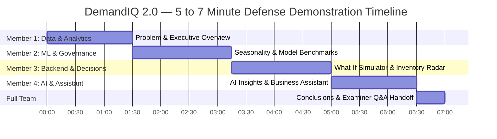

# DemandIQ 2.0 — Interactive Demonstration Script & Walkthrough

**Document Version:** 2.0.0  
**Phase:** Presentation & Viva Defense Sequence  
**Date:** October 2026  
**Presentation Format:** **5–7 Minute Collaborative Demonstration by a Team of 4**  
**Live URL:** `http://localhost:5173` (Backend: `http://127.0.0.1:8000`)  

---

## 1. Demonstration Team Role Assignment & Timing

The 5–7 minute demonstration is segmented into four sequential, cohesive segments. Each team member presents their owned module before handing off to the next:



| Segment | Speaker | Module / Screens | Time Allocation | Key Message to Examiner |
| :---: | :--- | :--- | :---: | :--- |
| **Part 1** | **Member 1 (Data & Analytics)** | Executive Overview (`/`), Trends (`/trends`) | 0:00 – 1:30 | 48-month synthetic dataset, SQLite persistence, mathematical integrity, MoM momentum. |
| **Part 2** | **Member 2 (ML & Forecasting)** | Seasonality (`/seasonality`), Benchmarks (`/model-performance`) | 1:30 – 3:15 | Leakage-free lag engineering, chronological 80/20 split, WAPE metrics, Beauty MA-3 honest reporting. |
| **Part 3** | **Member 3 (Backend & Decisions)** | Forecast (`/forecast`), Simulator (`/predict-demand`), Inventory (`/inventory`) | 3:15 – 5:00 | FastAPI REST endpoints, Pydantic validation, $LTD=D \times L / 30$, advisory replenishment, non-causal pricing. |
| **Part 4** | **Member 4 (Frontend & AI Assistant)** | Insights (`/insights`), Assistant (`/assistant`) | 5:00 – 6:30 | React 19 UI, structured insight schemas, canonical queries, COGS boundary guardrail, offline fallback. |
| **Handoff** | **All 4 Members** | Q&A / System Summary | 6:30 – 7:00 | Project wrap-up and transition to viva questions. |

---

## 2. Pre-Demonstration Environment Launch

### Terminal 1: FastAPI Backend Service
```powershell
# From project root:
cd backend
.\venv\Scripts\python.exe -m uvicorn app.main:app --reload --port 8000
```
*Health verification:* Open `http://127.0.0.1:8000/api/status` in browser. Expect `"status": "ok"`, `"records": 8048`, `"all_trained": true`.

### Terminal 2: React Vite Frontend Client
```bash
# From project root:
cd frontend
npm run dev
```
*Application access:* Open `http://localhost:5173` in Google Chrome or Microsoft Edge.

---

## 3. Step-by-Step Demonstration Sequence (5–7 Minutes)

### Part 1: Executive Overview & Data Foundations (Member 1 — Minutes 0:00 to 1:30)

1. **Navigation:** Open browser to `http://localhost:5173/`.
2. **Narration & Screen Actions:**
   - *"Good morning, members of the evaluation committee. We are presenting DemandIQ 2.0, a retail demand forecasting and inventory decision-support platform."*
   - Point to top header bar:
     - Notice the **Live System** badge and the **Historical Data Cycle: Dec 2024 (Dataset End Date)** indicator.
     - Highlight the **SQLite (8.0k rows)** and **ML: 4 XGBoost Models** status chips.
   - Point to the blue governance banner:
     - *"DemandIQ operates on a verified 100% synthetic dataset spanning 48 consecutive calendar months from January 2021 through December 2024. All next-period projections represent a January 2025 Historical Prototype Forecast."*
   - Review top KPI cards:
     - Gross Revenue: $\approx \$1.43\text{M}$ across 8,048 transactions and 20 catalog SKUs.
     - Average Selling Price (ASP): $\$50.28$.
     - Revenue Growth: $+5.4\%$ MoM.
   - Click navigation link to `/trends`:
     - Highlight the **Sales Velocity Ranking**: observe *Accelerating* items (e.g., Jacket in Clothing at $+54.5\%$ MoM) vs. *Decelerating* products.
   - **Handoff:** *"I will now hand over to Member 2 to explain how we engineered features and evaluated machine learning models across these seasonal patterns."*

---

### Part 2: Seasonality & Model Benchmark Governance (Member 2 — Minutes 1:30 to 3:15)

1. **Navigation:** Click `/seasonality` on the sidebar.
2. **Narration & Screen Actions:**
   - Point to the Seasonal Demand Index chart:
     - *"Retail demand is highly cyclical. For example, Sunscreen peaks sharply in summer (index > 2.0), while Jackets surge in winter."*
     - Point to the **Holiday Demand Surge**: $+18.4\%$ observed lift during promotional shopping days.
3. **Navigation:** Click `/model-performance` on the sidebar.
4. **Narration & Screen Actions:**
   - Explain the machine learning methodology:
     - *"We reject random k-fold cross-validation because future data would leak into past predictions. Instead, we enforce an 80% chronological training split (36 months: April 2021 – March 2024) and an untouched 20% hold-out test set (9 months: April 2024 – December 2024)."*
     - *"Every feature is strictly shifted ($y_{t-1}, y_{t-2}, \text{rolling}(3)$) so target period $y_t$ is completely barred from input vectors."*
   - Point to the **Model Benchmark Scorecard**:
     - *"Rather than assuming XGBoost is superior, we benchmark it against Naive (Lag-1), Seasonal-Naive (Lag-12), and a 3-Month Moving Average using WAPE (Weighted Absolute Percentage Error)."*
     - Point to **Clothing**: XGBoost wins with $10.22\%$ WAPE ($37.18$ units MAE) vs. Naive ($13.04\%$).
     - Point to **Electronics**: XGBoost wins with $9.51\%$ WAPE ($24.40$ units MAE) vs. Seasonal-Naive ($12.29\%$).
     - Point to **Beauty**: Highlight the transparent finding:
       *"Notice that in Beauty, the 3-Month Moving Average baseline won with 15.17% WAPE vs 22.17% for XGBoost. Beauty has steady repeat replenishment where rolling smoothing dampens noise better than decision trees. DemandIQ transparently selects the moving average for Beauty."*
   - **Handoff:** *"Member 3 will now demonstrate how these forecasts drive our what-if simulator and inventory replenishment engine."*

---

### Part 3: What-If Simulation & Inventory Risk Radar (Member 3 — Minutes 3:15 to 5:00)

1. **Navigation:** Click `/predict-demand` on the sidebar.
2. **Narration & Screen Actions:**
   - *"Our FastAPI backend serves real-time predictions in under 15ms through a cached ModelRegistry without on-the-fly retraining."*
   - Select **Electronics**, leave default inputs ($Price = \$120$, $Promo = 10\text{ days}$), and click **Run Forecast**:
     - Observe the predicted demand with its **95% Parametric Prediction Interval** ($\pm 1.96 \times s_{\text{test}}$), calibrated against hold-out RMSE.
   - Demonstrate Pydantic v2 input validation:
     - Change Promo Days to $35$ or Month to February with $30$ days $\implies$ Show the instant frontend/backend validation guard rejecting impossible calendar values.
3. **Navigation:** Click `/inventory` on the sidebar.
4. **Narration & Screen Actions:**
   - Explain the Inventory Intelligence formulas:
     - *"Because forecasts predict 30-day demand, demand during vendor fulfillment is proportionally calculated as $LTD = D \times L / 30$."*
     - *"Reorder points are set as $ROP = LTD + SS$, and target stock eliminates boundary cliff discontinuities."*
   - Point to **Clothing**:
     - Status: **Critical Stockout Risk** ($I_{\text{current}} \le LTD$).
     - Current stock cannot cover lead-time fulfillment demand.
     - Suggested Replenishment Quantity: displays recommended units to restore safe buffers.
   - Point to **Beauty**:
     - Status: **Overstock Surplus** (stock exceeds forward demand by $> 2.5\times$).
   - Point to the **Automated Ordering Disclaimer**:
     - *"Notice the explicit notice: Automated ordering is disabled (`automated_ordering_enabled = false`). All recommendations are strictly advisory."*
   - Scroll to **Pricing Observations**:
     - Explain empirical price elasticity (Clothing $\epsilon = -1.42$).
     - Emphasize: *"This is correlation, not causation. The database does not record wholesale COGS or supplier invoices, so the system explicitly disclaims profit optimization."*
   - Click **Download CSV Audit Report** to demonstrate 1-click inventory export.
   - **Handoff:** *"Member 4 will now demonstrate our Structured AI Insights and conversational Business Assistant."*

---

### Part 4: Structured AI Insights & Business Assistant (Member 4 — Minutes 5:00 to 6:30)

1. **Navigation:** Click `/insights` on the sidebar.
2. **Narration & Screen Actions:**
   - *"To prevent the hallucinations common in retail AI, our Structured Insights Engine produces auditable, normalized cards."*
   - Show the cards with deterministic IDs (e.g., `INS-INV-CLOTHING-STOCKOUT`, `INS-MODEL-BENCHMARK-001`).
   - Point out the `evidence_quality` badge (`HIGH_EMPIRICAL`, `ESTIMATED_RUN_RATE`, `MODEL_BENCHMARK`) and explicit assumptions.
   - Click **Copy Executive Briefing** to demonstrate clipboard integration.
3. **Navigation:** Click `/assistant` on the sidebar.
4. **Narration & Screen Actions:**
   - *"Our Business Assistant is strictly data-grounded. It extracts metrics directly from our verified backend services."*
   - **Live Interaction 1 (Canonical Inventory Risk):**
     - Click suggested prompt chip: **"Which categories show the greatest inventory risk?"**
     - Show the returned answer: Intent badge `INVENTORY_POLICY`, reference period `2025-01 (Historical Prototype Forecast)`, supporting metric chips for stockout counts, and reorder units.
     - Expand the **Assumptions & Limitations** drawer showing lead-time run rates.
   - **Live Interaction 2 (Absent Data Guardrail):**
     - Type and send: `"What are our wholesale supplier costs and gross profit margins?"`
     - Observe the response: The assistant politely returns an `UNAVAILABLE` declaration, explaining that wholesale COGS and margins are not tracked in the schema, avoiding hallucinated financial figures.
   - **Live Interaction 3 (Ambiguous Query Guardrail):**
     - Type and send: `"price?"`
     - Observe the response: The assistant flags the query as `AMBIGUOUS` and asks a clarifying question offering inventory, trend, or pricing options.
   - **Live Interaction 4 (Order Placement Guardrail):**
     - Type and send: `"Place a purchase order for 300 units of Clothing"`
     - Observe the response: The assistant explicitly reminds the user that automated ordering is disabled and purchase orders require human manager authorization.

---

### Part 5: Conclusion & Examiner Handoff (All Members — Minutes 6:30 to 7:00)

- **Member 4:** *"To summarize, DemandIQ 2.0 demonstrates how modern retail software can combine machine learning with rigorous governance, deterministic business logic, and responsible AI guardrails."*
- **Member 1:** *"The entire platform is backed by 81 automated Pytest test cases with a 100% pass rate."*
- **Full Team:** *"We thank the committee for your time and welcome your questions."*

---

## 4. Fail-Safe System Recovery Playbook

If any component experiences an unexpected issue during the live presentation, execute these exact recovery steps:

| Incident / Symptom | Root Cause | Exact Recovery Procedure |
| :--- | :--- | :--- |
| **Backend API Connection Refused (`ERR_CONNECTION_REFUSED`)** | Uvicorn server is not running or crashed. | 1. Open Terminal 1.<br>2. Run: `cd backend`<br>3. Run: `.\venv\Scripts\python.exe -m uvicorn app.main:app --reload --port 8000`<br>4. Refresh browser at `http://localhost:5173`. |
| **Port 8000 Already in Use (`WinError 10048`)** | A dangling Python process is holding port 8000. | 1. Run in PowerShell: `Get-Process python \| Stop-Process -Force`<br>2. Restart: `.\venv\Scripts\python.exe -m uvicorn app.main:app --reload --port 8000`. |
| **External LLM Unavailable / Slow / Quota Exceeded** | Google Gemini API key missing or Ollama daemon not running. | **Zero Recovery Action Needed.** DemandIQ automatically detects this and falls back seamlessly to the built-in `DemandIQ Analytics Engine`. The assistant will answer all questions deterministically from database records. |
| **Database File Empty or Missing (`retail.db`)** | Database was wiped or uninitialized. | 1. In Terminal 1: `cd backend`<br>2. Run: `.\venv\Scripts\python.exe seed_data.py`<br>3. This regenerates the verified 8,048 records in under 3 seconds. |
| **Frontend Port 5173 Busy** | Vite started on port 5174 instead. | 1. Check Vite terminal for active URL (e.g., `http://localhost:5174`).<br>2. Open that URL; FastAPI's CORS configuration already allows both port 5173 and 5174. |
| **Frontend White Screen or Chunk Load Error** | Browser cached old build bundle. | Perform a hard refresh: Press `Ctrl + Shift + R` (or `Cmd + Shift + R` on Mac). |

---

## 5. Live Demonstration Verification Checklist

- [x] January 2025 forecast is prominently labeled as a Historical Prototype Forecast.
- [x] Synthetic dataset provenance (2021–2024, 8,048 records) is verified in header and disclaimers.
- [x] XGBoost model is transparently contrasted with baselines (MA-3 winning in Beauty is demonstrated).
- [x] MAE, RMSE, safe MAPE, and WAPE are clearly visible on the benchmark scorecard.
- [x] Proportional lead-time demand ($LTD = D \times L / 30$) and safety stock buffers are explained.
- [x] Pricing observations explicitly state correlation rather than causation and note absence of COGS.
- [x] Automated ordering is visibly declared as disabled across inventory and assistant screens.
- [x] Assistant guardrails successfully intercept unavailable COGS, ambiguous prompts, and ordering attempts.
- [x] Offline deterministic fallback ensures zero presentation downtime.
