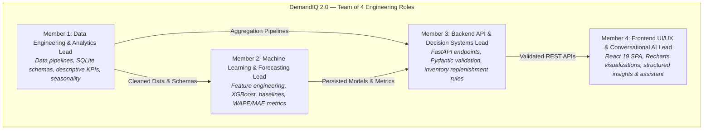

# DemandIQ 2.0 — Project Overview & Team Charter

**System Name:** DemandIQ 2.0 (Predictive Retail Demand & Inventory Decision-Support Platform)  
**Academic / Capstone Phase:** Production Prototype & Defense Delivery  
**Target Audience:** Category Planners, Merchandisers, Store Operators, and Technical Evaluators  
**Execution Context:** Collaborative Engineering Delivery by a **Team of 4**  
**Document Version:** 2.0.0  
**Date:** October 2026  

---

## 1. Team of 4 Structure & Responsibility Matrix

DemandIQ 2.0 was designed, implemented, evaluated, and documented through a modular division of responsibilities across four specialized engineering roles:

| Member / Role | Core Modules & Code Ownership | Key Responsibilities |
| :--- | :--- | :--- |
| **Member 1: Data Engineering & Analytics Lead** | `backend/generate_dataset.py` `backend/seed_data.py` `backend/app/db.py` `backend/app/analytics.py` `backend/tests/test_dataset_validation.py` `backend/tests/test_analytics.py` | • Synthetic retail data generation across 48 consecutive months (2021–2024). • SQLite database schema, table modeling, and indexing strategy. • Mathematical consistency ($Revenue = Q \times P \times (1-D)$). • Time-series analytics: YoY growth, MoM momentum, seasonality indices. |
| **Member 2: Machine Learning & Forecasting Lead** | `backend/app/ml.py` `backend/saved_models/*.pkl` `backend/tests/test_ml.py` `docs/ml_experiments.md` | • Feature engineering without look-ahead data leakage (`shift(1)`, `rolling(3)`). • Chronological train/test split (80% train / 20% hold-out without shuffling). • XGBoost regressors and baseline formulations (Naive, Seasonal-Naive, MA-3). • Evaluation metrics: MAE, RMSE, safe MAPE, and WAPE. • Prediction interval quantification ($s_{\text{test}}$ hold-out RMSE) and model persistence. |
| **Member 3: Backend API & Decision Systems Lead** | `backend/app/main.py` `backend/app/config.py` `backend/app/schemas.py` `backend/app/recommendations.py` `backend/app/routers/` `backend/tests/test_inventory_and_pricing.py` `backend/tests/test_api_endpoints.py` | • FastAPI async application architecture, CORS middleware, and lifespan lifecycle. • Strict Pydantic v2 schemas and validation (finite numbers, days-in-month guards). • Inventory replenishment engine: $LTD = D \times L / 30$, safety stock, and reorder points. • Observational price elasticity calculations and non-causal markdown prompts. • Error handling, HTTP status codes (400, 404, 422, 503), and API contract tests. |
| **Member 4: Frontend UI/UX & Conversational AI Lead** | `frontend/src/App.jsx` `frontend/src/pages/*` `frontend/src/components/*` `backend/app/ai.py` `backend/tests/test_ai_insights_and_assistant.py` `docs/demo_script.md` | • React 19 / Vite single-page application with code-splitting (`React.lazy`/`Suspense`). • Recharts visual styling, responsive design tokens, and unified Axios client. • Structured AI Insights engine with deterministic IDs and evidence-quality labels. • Conversational Business Assistant with intent routing, guardrails, and offline fallbacks. • Demonstration choreography and live presentation walkthroughs. |

---

## 2. Problem Statement

Retail inventory management is caught in a persistent operational dilemma:
1. **The Cost of Overstocking:** Holding excess merchandise locks up scarce working capital, inflates warehousing carrying charges, and forces heavy end-of-season clearance markdowns that erode margins.
2. **The Cost of Understocking:** Stockouts lead directly to lost sales, damaged customer loyalty, and emergency supplier expediting fees.
3. **The Black-Box Machine Learning Trap:** Many modern predictive solutions deploy opaque gradient-boosted trees or deep learning architectures without benchmarking them against simple heuristic baselines. They often suffer from subtle data leakage (e.g., using random k-fold cross-validation on time-series data or incorporating current-month actuals into rolling features).
4. **The LLM Hallucination Threat:** The rise of generative AI in retail enterprise tools has created conversational bots that invent plausible-sounding but completely fictitious inventory figures, supplier costs, and profit projections, posing severe financial risks to store managers.

DemandIQ 2.0 directly addresses these challenges by uniting **chronologically verified machine learning**, **transparent heuristic baselines**, **deterministic supply chain replenishment rules**, and **strictly evidence-grounded AI insights**.

---

## 3. Project Objectives

DemandIQ 2.0 was engineered to fulfill four core technical and operational objectives:

1. **Implement Rigorous, Leakage-Free Time-Series Forecasting:**
   - Derive autoregressive and rolling features strictly from preceding periods ($t-1, t-2, t-3$).
   - Train category-specific XGBoost regression models on an 80% chronological training split (36 months) and validate them on a completely untouched 20% hold-out test set (9 months).
2. **Enforce Objective Baseline Governance:**
   - Benchmark XGBoost against three established time-series heuristics: Naive (Lag-1), Seasonal-Naive (Lag-12), and 3-Month Moving Average.
   - Transparently report and adopt the best model per category using supply-chain standard **WAPE** (Weighted Absolute Percentage Error), openly declaring where simple smoothing outperforms machine learning (as demonstrated in the *Beauty* category).
3. **Deliver Deterministic Inventory & Pricing Decision-Support:**
   - Approximate lead-time demand proportionally ($LTD = D \times L / 30$) to bridge single-month forecasts with multi-day supplier fulfillment cycles.
   - Establish dynamic safety stock ($SS$) and reorder points ($ROP = LTD + SS$) without cliff discontinuities.
   - Provide observational price elasticity metrics while strictly disclaiming causal profit optimization.
4. **Architect an Evidence-Grounded, Hallucination-Proof AI Assistant:**
   - Structure insights with deterministic identifiers, verified metrics, concrete operational recommendations, and explicit assumption boundaries.
   - Route conversational queries through deterministic backend services, gracefully rejecting out-of-scope inquiries (such as missing wholesale supplier costs) and clarifying ambiguous requests.

---

## 4. Scope & System Limitations

To maintain scientific rigor and operational honesty, DemandIQ 2.0 explicitly defines its dataset provenance, temporal boundaries, and operational limits:

| Dimension | Implemented Reality & Boundaries | Explicit System Limitations |
| :--- | :--- | :--- |
| **Data Provenance** | **100% Synthetic Dataset** generated reproducibly (`seed=42`) with realistic seasonality, promotions, and noise. Tagged with `is_synthetic = 1` and `data_source = "DemandIQ_Synthetic_Retail_v2"`. | Does not represent real-world commercial receipts. Generated specifically for prototype validation. |
| **Temporal Horizon** | Spans **48 consecutive calendar months: January 2021 through December 2024**. Raw transactional layer contains 8,048 records; monthly SKU training split comprises 720 records ($36 \text{ months} \times 20 \text{ SKUs}$). | Historical data terminates on December 31, 2024. No transactions exist or are fabricated beyond this date. |
| **Prototype Forecast** | Forecast outputs project demand for **January 2025** evaluated against the historical December 2024 baseline. | **Historical Prototype Forecast only.** Never represented as real-time or present-day predictions for current operational dates. |
| **Inventory Purchasing** | Provides advisory replenishment quantities ($Q_{\text{reorder}}$) based on target stock policies. | **Automated purchasing is strictly disabled** (`automated_ordering_enabled = false`). All purchase orders require human manager review and manual execution. |
| **Supplier Constraints** | Applies empirical supplier lead times (3–12 days; category average ~5–8 days), with a conservative **14-day default buffer** when untracked. | Confirmed incoming purchase orders in transit are untracked in the schema (defaulted to $0$). Multi-echelon warehousing is not modeled. |
| **Pricing Analytics** | Computes empirical price elasticity ($\epsilon = \frac{\% \Delta Q}{\% \Delta P}$) from promotional transaction variations. | **Correlation, not causation.** Database does not record wholesale supplier costs (COGS), freight, or net margins. Cannot optimize net profit. |

---

## 5. Key Implemented Features

DemandIQ 2.0 provides an end-to-end analytics and decision-support suite accessible via a responsive React dashboard:

1. **Executive Performance Overview (`/`):**
   - High-level KPIs: Gross Revenue, Total Units Sold, MoM Revenue Growth, Average Selling Price (ASP), Active SKU count.
   - 48-month continuous revenue and demand trajectory chart with category revenue share breakdown.
   - Best and worst performing product rankings by volume and revenue contribution.
2. **Sales Velocity & Momentum Tracking (`/trends`):**
   - MoM product sales momentum classifying SKUs into *Accelerating* (> +5%), *Decelerating* (< -5%), or *Stable*.
   - Historical category trajectory comparisons across multi-year intervals.
3. **Seasonality & Cyclicality Explorer (`/seasonality`):**
   - Monthly seasonal index breakdown uncovering annual peaks (e.g., Summer Sunscreen surge, Winter Jacket spikes).
   - Event and promotional lift quantification (e.g., +18.4% holiday shopping demand surge).
4. **Category Demand Forecasting & Simulation (`/forecast` & `/predict-demand`):**
   - Next-month (January 2025) historical prototype demand forecasts powered by persisted XGBoost models.
   - Parametric 95% prediction intervals ($\pm 1.96 \times s_{\text{test}}$) reflecting empirical out-of-sample hold-out error.
   - Interactive what-if scenario simulator allowing category planners to test custom price, promotion, and calendar assumptions.
5. **Model Governance & Benchmark Scorecard (`/model-performance`):**
   - Cross-category benchmark comparing XGBoost against Naive (Lag-1), Seasonal-Naive (Lag-12), and 3-Month Moving Average.
   - Standardized evaluation metrics: MAE, RMSE, safe MAPE, and WAPE.
   - Transparent selection reporting showing XGBoost winning in 3 of 4 categories, while openly selecting the 3-Month Moving Average in *Beauty*.
6. **Supply Chain & Inventory Risk Radar (`/inventory`):**
   - Real-time stockout risk alerts triggered when current inventory cannot cover lead-time demand ($I_{\text{current}} \le LTD$).
   - Overstock surplus detection flagging capital lockup where inventory exceeds forward demand by >2.5x.
   - Proportional suggested replenishment calculations with 1-click CSV audit report export.
7. **Structured AI Insights Engine (`/insights`):**
   - Normalized, auditable strategic cards across Trends, Seasonality, Inventory Risk, Pricing, and Model Limitations.
   - Assigned deterministic IDs (`INS-INV-CLOTHING-STOCKOUT`), evidence-quality ratings, supporting verified metrics, and explicit limitations.
8. **Conversational Business Assistant (`/assistant`):**
   - Natural-language Q&A interface routed to backend deterministic analytics.
   - Supporting metric chips and expandable assumption drawers for every answer.
   - Strict guardrails: rejects queries regarding absent COGS, clarifies ambiguous inputs, and refuses automated order placement.

---

## 6. Technology Stack

### Frontend Architecture
- **Framework:** React 19 Single Page Application.
- **Build Tool:** Vite 8 with ES module bundling and fast HMR.
- **Routing:** React Router 7 declarative routing with route-level code splitting (`React.lazy` and `Suspense`).
- **Data Visualization:** Recharts (responsive SVG Area, Bar, and Line charts with gradients and custom tooltips).
- **HTTP Client:** Axios with centralized timeout configuration, error interception, and normalized error states.
- **Styling:** Modern Vanilla CSS design system using CSS variables, dark-accented sidebar, responsive drawer navigation, and accessible typography.

### Backend Architecture
- **Web Framework:** FastAPI (async Python 3.10+ / ASGI application via Uvicorn).
- **Data Validation:** Pydantic v2 schemas enforcing type safety, finite float checks, and calendar day constraints.
- **Database & ORM:** SQLite database accessed via SQLAlchemy 2.0 ORM session factories.
- **Data Processing:** Pandas and NumPy for vectorized aggregations, shift transformations, and rolling window metrics.

### Machine Learning & Evaluation
- **Predictive Engine:** XGBoost Regressors (`xgb.XGBRegressor`, `n_estimators=100, max_depth=3, learning_rate=0.1`).
- **Evaluation Toolkit:** Scikit-Learn metrics and custom implementations of safe MAPE and WAPE.
- **Persistence Layer:** Python `pickle` serializing model estimators, residual standard deviations, schemas, and benchmark metrics into `backend/saved_models/`.
- **Runtime Registry:** In-memory `ModelRegistry` ensuring zero on-the-fly retraining during inference requests.

### AI & Language Model Infrastructure
- **Cloud LLM Support:** Google Gemini API (`gemini-2.5-flash` or configured model via `GEMINI_API_KEY`).
- **Local LLM Support:** Ollama (`gemma3:4b` or local model via HTTP API).
- **Offline / Deterministic Fallback:** Built-in DemandIQ Analytics Engine providing guaranteed, zero-downtime analytical synthesis without external API dependencies.

### Quality Assurance & Testing
- **Test Runner:** Pytest with `pytest-asyncio` and `httpx`.
- **Suite Coverage:** **81 automated test cases (100% pass rate)** spanning dataset validation, ML integrity, inventory formulas, AI assistant guardrails, and API contracts.
