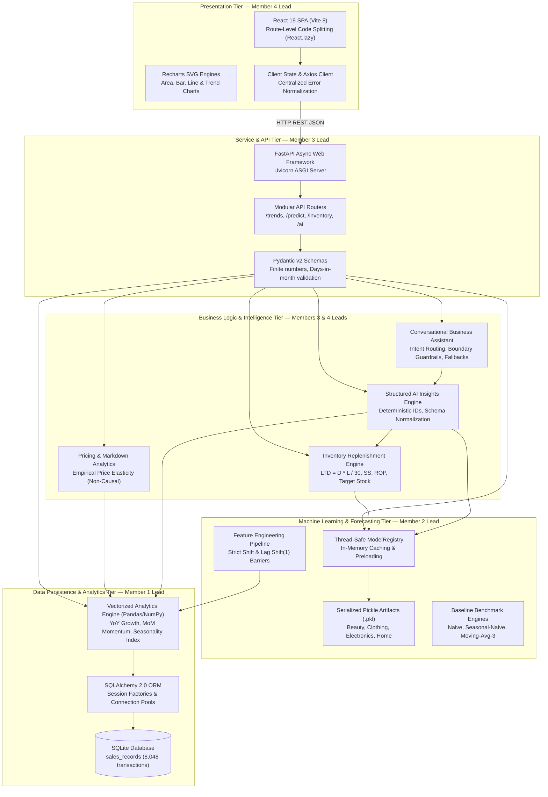
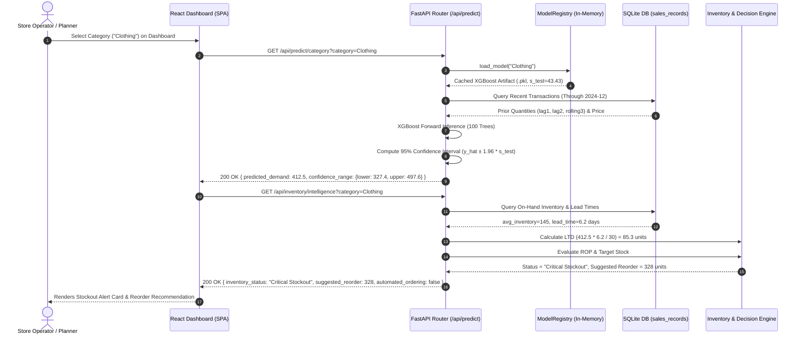

# DemandIQ 2.0 — System Architecture & Technical Specifications

**Platform Version:** 2.0.0  
**Status:** Validated & Implemented  
**Date:** October 2026  
**Engineering Ownership:** Collaborative Implementation by a **Team of 4**  

---

## 1. End-to-End System Architecture

DemandIQ 2.0 employs a decoupled client-server architecture engineered for high-performance retail analytics, zero-leakage machine learning inference, and evidence-grounded decision support:



---

## 2. Team-of-4 Architectural Ownership Matrix

To maintain clean separation of concerns and clear presentation boundaries during evaluation, system components are partitioned across four specialized technical domains:

| Architecture Domain | Primary Lead | Key Files Owned | Core Interfaces & Responsibilities |
| :--- | :--- | :--- | :--- |
| **Data Persistence & Analytics** | **Member 1** | `backend/app/db.py`<br>`backend/app/analytics.py`<br>`backend/seed_data.py`<br>`backend/generate_dataset.py` | • Database schema design, indices, and connection management.<br>• Transaction querying, time-series aggregation, and Pandas dataframes.<br>• Month-over-month sales momentum and seasonality indices. |
| **Machine Learning & Baselines** | **Member 2** | `backend/app/ml.py`<br>`backend/saved_models/*.pkl`<br>`backend/tests/test_ml.py` | • Autoregressive feature transformation with strict leakage barriers.<br>• XGBoost model training, hyperparameter tuning, and serialization.<br>• Baseline models (Naive, Seasonal Naive, MA-3) and WAPE scoring.<br>• ModelRegistry caching and out-of-sample prediction intervals. |
| **API Architecture & Decision Rules** | **Member 3** | `backend/app/main.py`<br>`backend/app/schemas.py`<br>`backend/app/recommendations.py`<br>`backend/app/routers/*` | • FastAPI lifecycle, CORS, routing, and Pydantic v2 schemas.<br>• Deterministic replenishment policies ($LTD$, $SS$, $ROP$, Target stock).<br>• Observational price elasticity and markdown advisory flags.<br>• HTTP error codes, finite-number guards, and API contract parity. |
| **Frontend UI/UX & AI Assistant** | **Member 4** | `frontend/src/*`<br>`backend/app/ai.py`<br>`backend/tests/test_ai_insights_and_assistant.py` | • React 19 single-page application with responsive CSS design tokens.<br>• Interactive Recharts dashboards and CSV export mechanisms.<br>• Structured AI insights engine and conversational Assistant.<br>• Natural language guardrails against hallucination and missing COGS. |

---

## 3. Component Architecture Deep-Dive

### 3.1 React Frontend Architecture (Member 4 Lead)
- **Framework & Runtime:** React 19.0 running inside Vite 8.
- **Route-Level Code Splitting:** Pages are lazily imported via `React.lazy()` and rendered inside a top-level `<Suspense>` boundary wrapped in a consistent `<LoadingState>` component:
  - `ExecutiveSummary.jsx`: High-level business overview and KPIs.
  - `Trends.jsx`: MoM sales momentum and SKU velocity rankings.
  - `Seasonality.jsx`: Annual cyclicality indices and holiday surge analysis.
  - `Forecast.jsx`: Category demand forecasts and prediction intervals.
  - `PredictDemand.jsx`: Interactive what-if custom simulation sandbox.
  - `ModelPerformance.jsx`: Model benchmark scorecards and error charts.
  - `InventoryRisk.jsx`: Stockout, overstock, and replenishment radar with CSV export.
  - `AIInsights.jsx`: Structured strategic insights cards with clipboard copying.
  - `Assistant.jsx`: Conversational business assistant with metric chips and drawer details.
- **Unified API Client (`api.js`):** Encapsulates Axios with base URL resolution, timeout controls, and unified error payload normalization (`err.response?.data?.detail`).
- **Design System (`index.css`):** Employs CSS custom properties (variables) for consistent color tokens (dark navy `#0f172a`, primary blue `#2563eb`, border `#e2e8f0`), accessible typography (Inter/system-ui), micro-animations, and responsive mobile drawers.

### 3.2 FastAPI Backend Architecture (Member 3 Lead)
- **ASGI Core:** Powered by FastAPI and Uvicorn with async event loop support.
- **Application Lifespan (`lifespan` context manager):** Preloads and validates all four serialized XGBoost models into the `ModelRegistry` during server startup, verifying feature signatures and non-zero residual errors before accepting incoming requests.
- **CORS Middleware:** Configured with explicit origin allowances (`localhost:5173`, `127.0.0.1:5173`, and port-range regexes) to support smooth cross-origin requests from development and production environments.
- **Modular Routers:**
  - `routers/trends.py`: Exposes `/api/summary`, `/api/trends/categories`, `/api/trends/products`, `/api/seasonality`.
  - `routers/predictions.py`: Exposes `/api/predict/all`, `/api/predict/category`, `/api/predict/custom`, `/api/predict/batch`, `/api/ml/benchmark`, `/api/ml/status`, `/api/ml/feature-schema`.
  - `routers/recommendations.py`: Exposes `/api/inventory/intelligence`, `/api/pricing/insights`, `/api/recommendations`.
  - `routers/ai.py`: Exposes `/api/ai/structured-insights`, `/api/ai/assistant`.

### 3.3 SQLite Database & Persistence Tier (Member 1 Lead)
- **Relational Storage:** Embedded SQLite database (`backend/data/retail.db` or configured via `DATABASE_URL`).
- **ORM Layer:** SQLAlchemy 2.0 with declarative base mapping to table `sales_records`.
- **Database Schema & Table Layout:**
  - `id` (Integer, Primary Key)
  - `order_date` (Date, Indexed): 48 months from 2021-01-01 to 2024-12-31.
  - `sku_id` (String, Indexed) & `product_name` (String, Indexed): 20 stable catalog items.
  - `product_category` (String, Indexed): *Beauty*, *Clothing*, *Electronics*, *Home*.
  - `quantity` (Integer), `unit_price` (Float), `discount` (Float), `revenue` (Float).
  - `promotion_flag` (Boolean), `holiday_flag` (Boolean), `season` (String).
  - `current_inventory` (Integer), `lead_time_days` (Integer), `safety_stock` (Integer), `reorder_point` (Integer).
  - `is_synthetic` (Boolean, Default True), `data_source` (String, Default `"DemandIQ_Synthetic_Retail_v2"`).
- **Session Lifecycle:** Managed via FastAPI dependency injection (`Depends(get_db)`) using `SessionLocal` with context-managed closure (`finally: db.close()`).

### 3.4 Data Processing & Analytics Engine (Member 1 Lead)
- **Vectorized Data Transformations (`analytics.py`):**
  - Aggregates raw order records into category-month and SKU-month historical panels.
  - Computes Year-over-Year (YoY) revenue and volume growth rates by aligning identical calendar quarters across successive years.
  - Computes Month-over-Month (MoM) product momentum:
    $$\text{Growth}_{\text{MoM}} = \frac{Q_{\text{latest}} - Q_{\text{prior}}}{Q_{\text{prior}}} \times 100\%$$
    Classifying items into *Accelerating* ($> +5\%$), *Decelerating* ($< -5\%$), or *Stable*.
  - Calculates the **Normalized Seasonal Demand Index**:
    $$\text{Index}_{\text{month}} = \frac{\bar{D}_{\text{month}}}{\bar{D}_{\text{annual}}} \times 100$$
    Revealing demand surges during holiday peaks and summer weather cycles.

### 3.5 Forecasting Models & Persisted Artifacts (Member 2 Lead)
- **Feature Engineering Pipeline (`ml.py`):**
  Constructs a strict 7-feature schema for every category month:
  1. `month_num`: Calendar month integer (1–12) for cyclical seasonality.
  2. `avg_price`: Realized average selling price in dollars.
  3. `promo_days`: Number of active promotion days in target month.
  4. `holiday_days`: Number of recognized holiday shopping days in target month.
  5. `lag1`: Autoregressive prior-month demand ($y_{t-1} = \text{shift}(1)$).
  6. `lag2`: Autoregressive two-month prior demand ($y_{t-2} = \text{shift}(2)$).
  7. `rolling3`: 3-month rolling mean strictly over past observations ($\text{shift}(1).\text{rolling}(3).\text{mean}()$).
- **Strict Data Leakage Barrier:** Target variable $y_t$ is completely excluded from feature generation. Unit test `test_feature_leakage_prevention` verifies that modifying $y_t$ does not alter feature vectors at period $t$.
- **Chronological Hold-Out Splitting:**
  - 80% Chronological Training Set: 36 months (April 2021 through March 2024, after dropping 3-month feature warm-up).
  - 20% Chronological Test Set: 9 months (April 2024 through December 2024). Completely untouched during tree training.
- **Model Algorithms & Hyperparameters:**
  `xgb.XGBRegressor(n_estimators=100, max_depth=3, learning_rate=0.1, random_state=42, objective='reg:squarederror')`.
  Shallow depth ($d=3$) explicitly prevents overfitting on monthly aggregated sequences.
- **Baseline Formulations:**
  - *Naive:* $\hat{y}_t = y_{t-1}$.
  - *Seasonal-Naive:* $\hat{y}_t = y_{t-12}$ (with fallback to $y_{t-1}$ if unavailable).
  - *Moving Average (3-Month):* $\hat{y}_t = \frac{y_{t-1} + y_{t-2} + y_{t-3}}{3}$.
- **Evaluation Metric Formulas:**
  - $\text{MAE} = \frac{1}{N} \sum |y_i - \hat{y}_i|$
  - $\text{RMSE} = \sqrt{\frac{1}{N} \sum (y_i - \hat{y}_i)^2}$
  - $\text{Safe MAPE} = \frac{100}{N_{y>0}} \sum_{y_i > 0} \frac{|y_i - \hat{y}_i|}{y_i}$ (zero actuals masked to avoid division by zero).
  - $\text{WAPE} = \frac{\sum |y_i - \hat{y}_i|}{\sum y_i} \times 100\%$ (weighted absolute percentage error, immune to zero distortion).
- **Model Persistence & Artifact Specification:**
  Serialized to `saved_models/model_<Category>.pkl` using `pickle`. Each artifact contains:
  ```json
  {
    "model": "xgb.XGBRegressor instance",
    "residual_std": "float (Out-of-sample holdout test RMSE, s_test)",
    "metrics": {
      "mae": 37.18, "rmse": 43.43, "wape_pct": 10.22,
      "empirical_coverage_pct": 100.0,
      "baselines": { "naive": {...}, "seasonal_naive": {...}, "moving_average_3": {...} },
      "preferred_model": "XGBoost",
      "best_baseline": "naive"
    },
    "feature_schema": "FEATURE_SCHEMA dictionary",
    "features": ["month_num", "avg_price", "promo_days", "holiday_days", "lag1", "lag2", "rolling3"],
    "model_version": "2.0.0",
    "trained_at": "ISO UTC timestamp"
  }
  ```
- **Runtime Inference (`ModelRegistry`):** Caches deserialized models in memory. Requests to `/api/predict/category` or `/api/predict/all` execute forward passes on cached models in `< 15ms` with zero retraining.

### 3.6 Inventory & Pricing Decision Rules (Member 3 Lead)
- **Proportional Lead-Time Demand ($LTD$):**
  Because the ML model projects a 30-day forward demand volume ($D_{\text{forecast}}$), demand during supplier delivery days ($L$) is proportionally approximated as:
  $$LTD = D_{\text{forecast}} \times \left(\frac{L}{30.0}\right)$$
  Where $L$ is the empirical supplier lead time (3–12 days in catalog, category average ~5–8 days; 14-day default buffer if untracked).
- **Safety Stock ($SS$):**
  Established from historical monthly sales variance: $SS = Z \times \sigma_L$, buffering against unforeseen demand spikes.
- **Reorder Point ($ROP$):**
  $$ROP = LTD + SS$$
- **Net Available Inventory ($I_{\text{net}}$):**
  $$I_{\text{net}} = I_{\text{current}} + I_{\text{incoming}} - LTD$$
  *(Note: Confirmed incoming inventory $I_{\text{incoming}} = 0$ as open orders are untracked in prototype).*
- **Target Inventory & Suggested Replenishment ($Q_{\text{reorder}}$):**
  To prevent cliff discontinuities at the reorder boundary, DemandIQ uses a continuous target stock policy ($Target = D_{\text{forecast}} + SS$):
  $$Q_{\text{reorder}} = \begin{cases} 
  \max\left(0, \lceil Target - I_{\text{current}} - I_{\text{incoming}} \rceil\right) & \text{if } I_{\text{current}} \le ROP \text{ or } I_{\text{net}} < SS \\
  0 & \text{otherwise}
  \end{cases}$$
- **Stockout & Overstock Risk Classification:**
  - *Critical Stockout:* $I_{\text{current}} \le LTD$ or $I_{\text{current}} == 0$ (imminent breach before delivery arrives).
  - *Reorder Required:* $I_{\text{current}} \le ROP$ or $UpperCI > I_{\text{current}}$.
  - *Overstock Surplus:* $I_{\text{current}} > (UpperCI \times 1.5)$ and $I_{\text{current}} > (ROP \times 1.5)$, holding surplus units $\max(0, \text{round}(I_{\text{current}} - (D_{\text{forecast}} + SS)))$.
- **Observational Price Elasticity:**
  $$\epsilon = \frac{\% \Delta \text{ Demand}}{\% \Delta \text{ Realized Price}}$$
  Reported strictly as an empirical historical association. Because the database lacks wholesale cost of goods sold (COGS), the system disclaims causal profit guarantees and labels markdown prompts as working capital recovery advisories.

### 3.7 Evidence-Grounded AI Insights & Business Assistant (Member 4 Lead)
- **Structured Insight Engine (`generate_structured_insights`):**
  Synthesizes data from analytics, ML benchmarks, and inventory policies into normalized insight objects:
  - `id`: Deterministic unique identifier (e.g., `INS-INV-CLOTHING-STOCKOUT`).
  - `category`: `demand_trends`, `seasonality`, `inventory_risk`, `pricing_promotion`, `forecast_limitations`.
  - `severity`: `CRITICAL`, `WARNING`, `MEDIUM`, `INFO`.
  - `evidence_quality`: `HIGH_EMPIRICAL`, `MODEL_BENCHMARK`, `ESTIMATED_RUN_RATE`.
  - `supporting_metrics`: Dictionary of genuine numeric values with explicit units.
  - `recommendation`: Actionable advisory step (with human review reminders).
  - `limitations`: Explicit assumptions and system boundaries.
  - *Contradiction Guard:* Prevents simultaneous emission of stockout and surplus insights for the same category.
- **Conversational Business Assistant (`answer_business_question`):**
  Routes queries through deterministic intent matching:
  - *Canonical Business Inquiries:* Evaluates inventory risk, product replenishment, demand trends, forecast limitations, pricing insights, and executive summaries.
  - *Unavailable Data Guardrail:* Explicitly intercepts queries regarding wholesale costs, gross margins, supplier invoices, competitor pricing, or future 2026 data, explaining dataset schema limits.
  - *Ambiguous Query Handler:* Catches underspecified questions (e.g., `"price?"`, `"help"`) and provides structured clarifying options.
  - *Order Execution Guardrail:* Blocks automated purchase order execution attempts, reinforcing that ordering requires manual approval.
  - *Deterministic Analytical Fallback:* When external LLMs (Gemini/Ollama) are offline, the engine generates full analytical responses from verified database metrics with zero downtime.

---

## 4. API Request and Response Flow

The sequence diagram below illustrates the end-to-end data flow for a category demand forecast and inventory risk evaluation:



---

## 5. Security, Validation & Error Handling Architecture

1. **Input Validation Layer (Pydantic v2):**
   - Floating-point inputs are validated via `math.isfinite()` to reject `NaN`, `+Infinity`, and `-Infinity`.
   - Days-in-month validation enforces physical calendar boundaries (e.g., February $\le 29$, April $\le 30$).
   - Category names are matched case-insensitively and resolved to canonical names (`"clothing"` $\to$ `"Clothing"`).
2. **Standardized HTTP Status Codes:**
   - `200 OK`: Successful computation and retrieval.
   - `400 Bad Request`: Malformed business logic or invalid category request.
   - `404 Not Found`: Request for unsupported category or nonexistent resource.
   - `422 Unprocessable Entity`: Pydantic schema validation failures with detailed field error paths.
   - `500 Internal Server Error`: Corrupted model file or unhandled internal failure.
   - `503 Service Unavailable`: Missing model artifact on disk before training.
3. **Graceful Degradation:**
   - If optional LLM services (Gemini or Ollama) fail or disconnect, the system seamlessly transitions to the built-in deterministic `DemandIQ Analytics Engine` with zero disruption to the user experience.
